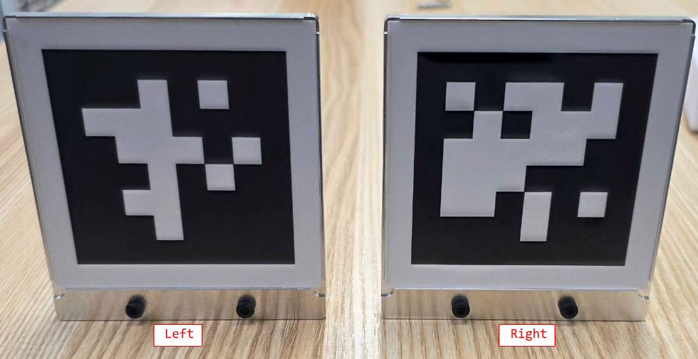
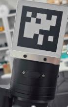
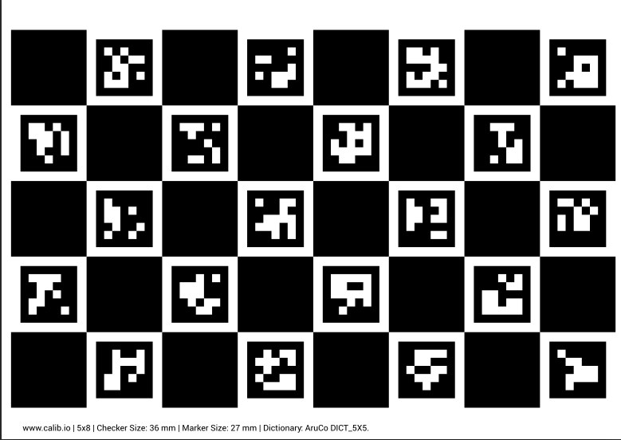
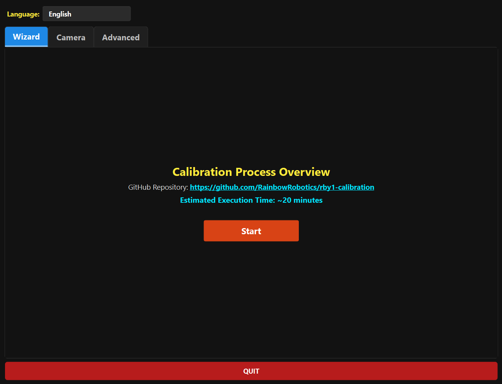

# Camera Calibration Manual

For questions, please contact rby.support@rainbow-robotics.com.

## Overview
This is a camera calibration tool for the robot to calibrate joint offsets and camera extrinsics.
It measures the two arm markers with the head camera and estimates the home offsets of both arms (14 joints) and the head (2 joints), the camera mounting pose and the marker brackets, then writes the offsets to the robot.

### 1. Supported Systems
- **OS**: Windows 10/11 x64, Ubuntu 22.04 (x86_64, Jetson Orin aarch64). Ubuntu 24.04 is not supported yet.
- **Python version**: 3.12
- **SDK compatibility**: rby1-sdk 0.10.x and later
- **Robot**: RB-Y1 v1.2, RB-Y1 v1.3, with or without the head camera
- **Camera**: Intel RealSense D405 (recommended), D435 (Resolution: 1280x720, 30 FPS)

### 2. Performance
- **Hand position accuracy at the symmetric check pose**: within about 1-3 mm

> [!NOTE]
> Performance can degrade depending on how much the head is misaligned, the lighting of the environment and the camera's lens distortion.

### 3. Required Equipment
- RB-Y1 robot and a PC with an Ethernet port (connected to the robot) and a **USB 3.0** port.
- Intel RealSense camera (D405 recommended) with a **USB 3.0 cable**, mounted on the head with the camera bracket.

> [!IMPORTANT]
> The camera cable must be USB 3.0.

#### 1. Marker Installation
You must remove the currently attached gripper and connect the marker plates **directly to the tool flange**.
- **Markers**: AprilTag 36h11 plate markers, 80 mm
- **Left Arm**: AprilTag ID 7
- **Right Arm**: AprilTag ID 8

 
   

> **Note** if you need disassembly gripper, see [disassembly gripper](https://rainbowco-my.sharepoint.com/:p:/g/personal/support_rainbow-robotics_com/IQD86a950aEVQqclH8O9vQxrAcXAZA4gEQ3921tDqwQIGH8?e=qRn473).

*(Please ensure the correct marker is attached to the corresponding arm.)*

#### 2. Checkerboard for the Camera Intrinsics Calibration
If you need to calibrate the camera's intrinsic parameters (focal length, principal point, distortion), you must use a checkerboard (Charuco board) with the size the app expects:
- **ChArUco 8 × 5 squares, square 36 mm, marker 27 mm, dictionary DICT_5X5_100**
- Ready to print: [`calib.io_charuco_297x210_5x8_36_27_DICT_5X5.pdf`](calib.io_charuco_297x210_5x8_36_27_DICT_5X5.pdf) (A4). Print at **100 % scale** (no "fit to page"), check that a square measures 36 mm, and keep the sheet flat (e.g. glued to a rigid board).



> **Note**: You can generate a custom checkerboard pattern for printing directly from this [calibration pattern generator](https://calib.io/pages/camera-calibration-pattern-generator?srsltid=AfmBOoqAjYAa0_4pvqsXpCtY4M4xypED4J00ImvgLCFQlP_ifqoVbll_), with the size above.

#### 3. Simulator (optional)
> [!NOTE]
> To test in the RB-Y1 simulator, install Docker and the RB-Y1 simulator image:
> <https://hub.docker.com/r/rainbowroboticsofficial/rby1-sim>

---

## Environment Setup
Follow the steps for your OS once per PC. Each step prevents a problem that otherwise only shows up when the app starts. To use the standalone executable instead, see [Standalone Executable](#standalone-executable): the target PC then only needs the steps marked **(also for the executable)**.

### 1. Clone the Repository
```bash
git clone https://github.com/RainbowRobotics/rby1-calibration.git
cd rby1-calibration
```

### 2. Windows
1. **Python 3.12** (64-bit) from python.org.
2. **Virtual environment and packages** (Command Prompt, in the repository folder):
   ```bat
   py -3.12 -m venv .venv
   .venv\Scripts\activate.bat
   python -m pip install --upgrade pip
   pip install -r requirements.txt
   pip install -e .
   ```
3. **Camera** (also for the executable): connect the RealSense to a **USB 3.0** port (blue port / SS mark) with a USB 3.0 cable.
4. **Robot network** (also for the executable): set the PC's Ethernet adapter to a fixed IP in the robot's subnet (e.g. `192.168.1.xxx` for a robot at `192.168.1.40`) and check `ping 192.168.1.40` before starting the app.

### 3. Ubuntu 22.04 (incl. Jetson Orin)
1. **Python 3.12**, installed next to Ubuntu's own Python 3.10. `apt`, Ubuntu's tools and JetPack keep using 3.10, so the system `python3` must stay 3.10; the app uses 3.12 only inside its `.venv` (step 4).
   1. Add the deadsnakes PPA and check that it has 3.12 for this PC (on Jetson Orin especially): the `Candidate:` line must not be `(none)`.
      ```bash
      sudo add-apt-repository ppa:deadsnakes/ppa
      sudo apt update
      apt-cache policy python3.12
      ```
   2. Install 3.12:
      ```bash
      sudo apt install -y python3.12 python3.12-venv
      ```
   3. Check that `python3` is still 3.10 and 3.12 is a separate command:
      ```bash
      python3 --version      # Python 3.10.x
      python3.12 --version   # Python 3.12.x
      ```
   - Do **not** point `python3` at 3.12 (no `update-alternatives --install /usr/bin/python3 ...`, no `ln -sf ... /usr/bin/python3`), and do not install packages with `sudo pip`.
   - If `python3 --version` already shows 3.12, set it back to 3.10: `sudo update-alternatives --config python3` and choose `/usr/bin/python3.10` if it was changed with `update-alternatives`, or `sudo ln -sf python3.10 /usr/bin/python3` if the link was changed by hand.
2. **Qt system library** (also for the executable; PySide6 6.5 and later will not start without it):
   ```bash
   sudo apt install -y libxcb-cursor0
   ```
3. **RealSense USB permission** (also for the executable; udev rule). Without it the camera can only be opened as root:
   ```bash
   sudo curl -L https://raw.githubusercontent.com/IntelRealSense/librealsense/master/config/99-realsense-libusb.rules \
        -o /etc/udev/rules.d/99-realsense-libusb.rules
   sudo udevadm control --reload-rules && sudo udevadm trigger
   ```
   Re-plug the camera afterwards, on a **USB 3.0** port.
4. **Virtual environment and packages** (in the repository folder):
   ```bash
   python3.12 -m venv .venv
   source .venv/bin/activate
   python -m pip install --upgrade pip
   pip install -r requirements.txt
   pip install -e .
   ```
5. **Display** (also for the executable): run the app from the desktop session of the PC (it is a GUI). Over SSH it needs X11 forwarding (`ssh -X`); a plain SSH shell gives `could not connect to display`.
6. **Robot network** (also for the executable): give the Ethernet port a fixed IP in the robot's subnet (e.g. `192.168.1.xxx`) and check `ping 192.168.1.40`.

> [!NOTE]
> OpenCV is installed as `opencv-contrib-python-headless` (same version, without OpenCV's own GUI). The full `opencv-contrib-python` brings its own Qt plugins, which clash with PySide6 on Linux (`Aborted` at start). The app does not use OpenCV windows.
> An existing `.venv` made with the old requirements must drop the old package first, since both install the same `cv2` module:
> `pip uninstall -y opencv-contrib-python && pip install -r requirements.txt`

> [!NOTE]
> - `requirements.txt` gives minimum versions, so a new install takes the latest releases. Tested with this set (Windows, Python 3.12.10, RB-Y1 v1.2 robot, 2026-10): rby1-sdk 0.10.0, pyrealsense2 2.59.1, numpy 2.5.4, scipy 1.18.1, matplotlib 3.11.2, PySide6 6.12.0, opencv-contrib-python-headless 4.13.0.92, qpsolvers 4.11.0, osqp 1.1.1. If a later release breaks the app, install these versions.
> - On Ubuntu 22.04 for Jetson (aarch64), recent PySide6 releases need a newer glibc than 22.04 has, so pip picks an older PySide6 that fits (for example 6.7.2) on its own. That version has not been tested with the app.
---

## Running the Calibration
### 1. Launch
With the virtual environment active, launch the main UI:
```bash
python main_ui.py
```
or use the launchers `run_windows.bat` (Windows) / `scripts/linux/run_linux.sh` (Linux), which activate `.venv` first.
From the UI, you can connect to the robot, initialize the pose, and run Step 1 (joint offsets and marker brackets), Step 1.5 (head camera) and Step 2 (whole-system calibration) automatically.

To begin, click the **Start** button; the wizard guides you through the rest.



> [!NOTE]
> All calibration results, intermediate captured data, error calculation logs, and graphical plots are automatically saved and available in the `result` folder.

### 2. Swapping the Camera / Unlisted RealSense Models
- The app reads the connected camera's model on startup and configures itself from it. Variants of one body share a single entry: a D435, D435i and D435f are all handled as **D435**.
- Bracket extrinsics come from that model's entry in [`config/camera_info.yaml`](config/camera_info.yaml), and the intrinsics from `config/camera_intrinsics_<model>.yaml` (e.g. `camera_intrinsics_d435.yaml`), which is copied into the working `config/camera_intrinsics.yaml`. The outgoing camera's calibration is archived to its own file first, so swapping back and forth loses nothing.
- `setting.yaml`'s `mount_to_cam` / `head_base_to_cam` are only reset when the model actually changes; a Step 1.5 / Step 2 result for the *same* model survives a restart. The `*_nominal` keys always track `camera_info.yaml`, because Step 1.5 and Step 2 use them as the CAD baseline.
- For a model that has no entry yet, the app starts with an error dialog and changes nothing: measure `head_base_to_cam` and `mount_to_cam` for its colour lens, add them to `config/camera_info.yaml`, then run the Step 1 intrinsics calibration and save it. Do **not** add a placeholder entry of zeros — it would be applied as if it had been measured.

---

## Standalone Executable

If you want to run the calibration tool as a standalone portable application on other PCs without installing Python or setting up source environments:

### 1. Automated One-Click Build Scripts

#### Windows Build
On a Windows PC with Python 3.12 installed, run:
```bat
scripts\windows\build_windows.bat
```
The script will automatically create a `.venv`, install all dependencies (`rby1-sdk`, `pyrealsense2`, `PySide6`, etc.), and generate `dist\camera_calibrator_AMD64.exe`.

#### Linux Build (Ubuntu / Jetson)
On Linux (after steps 1-2 of the Ubuntu setup above):
```bash
./scripts/linux/build_linux.sh
```
The script will automatically set up the virtual environment and output `dist/camera_calibrator_x86_64` (or `camera_calibrator_aarch64` on Jetson). **Build on Ubuntu 22.04** (see the glibc note below).

### 2. Manual Compilation Command
If building manually using PyInstaller (not in `requirements.txt`; the build scripts install it):
```bash
pip install pyinstaller
pyinstaller camera_calibrator.spec
```

### 3. Output & Portability
- The compiled standalone executable is generated at `dist/camera_calibrator_<arch>` (e.g., `camera_calibrator_x86_64` on PC, `camera_calibrator_aarch64` on Jetson Orin).
- **Zero-Dependency Portable Behavior**: This executable packages all dependencies (including PySide6, OpenCV, Matplotlib, OSQP solver, and the Robot SDK). 
- If you move the executable to any other clean directory and run it, it will automatically detect the absence of configurations, create a local `config/` directory next to itself, and copy the default settings templates (`setting.yaml`, `ready_poses.yaml`, `camera_intrinsics.yaml`) to that folder on startup. Any calibration result plots/logs will also be saved locally next to the executable in a `result/` folder.

### 4. Target PC Requirements
The executable bundles Python and all packages, but the target PC still needs the steps of [Environment Setup](#environment-setup) marked **(also for the executable)**:
* **Linux**: `libxcb-cursor0`, the RealSense udev rule, a desktop session.
* **All**: the camera on USB 3.0 and the Ethernet port in the robot's subnet.

Build constraints that setup cannot remove:
* **glibc**: a Linux binary runs only on the Ubuntu version it was built on or newer (Ubuntu 22.04 = glibc 2.35), so build it on 22.04.
* **Architecture**: PyInstaller does not cross-compile. Build the Jetson (aarch64) binary on the Jetson itself with the same steps; the output is named `dist/camera_calibrator_aarch64`.
